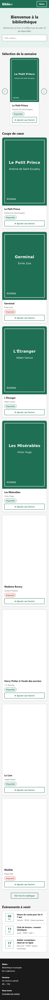
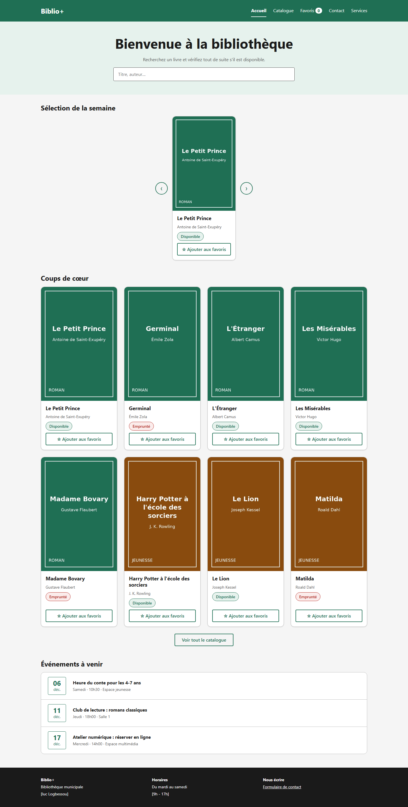

# Biblio+

Site de la bibliothèque municipale : recherche et réservation de livres, favoris, agenda des événements. Accessible (RGAA / WCAG) et responsive.

- Site en ligne : https://bibliopluss.netlify.app/
- Dépôt : https://github.com/BLVCKNESSS/biblio-plus

## Captures

| Mobile | Desktop |
|---|---|
|  |  |

## Lancer le projet

```sh
npm install
npm run dev          # http://localhost:5173
npm run build        # génère dist/
npm run preview      # http://localhost:4173
npm run test:unit    # tests Vitest
npx playwright test  # tests responsive
```

## Stack

Vue 3 (Composition API, `<script setup>`) · Vite · Vue Router · Pinia · Vitest · Playwright · ESLint · Prettier · Netlify

## Fonctionnalités

**Must**
- … (ex. catalogue avec recherche, filtre, tri et pagination)
- … (ex. page détail d'un livre)
- … (ex. formulaire de contact validé)

**Should**
- … (ex. favoris persistants, réservation par modale)

## Performance (Lighthouse mobile)

| Page | Perf. avant → après | Accessibilité | Bonnes pratiques | SEO |
|---|---|---|---|---|
| Accueil | … → … | … | … | … |
| Catalogue | … → … | … | … | … |

## Difficultés rencontrées

- …
- …